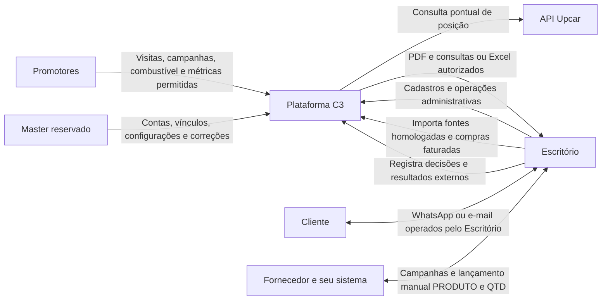
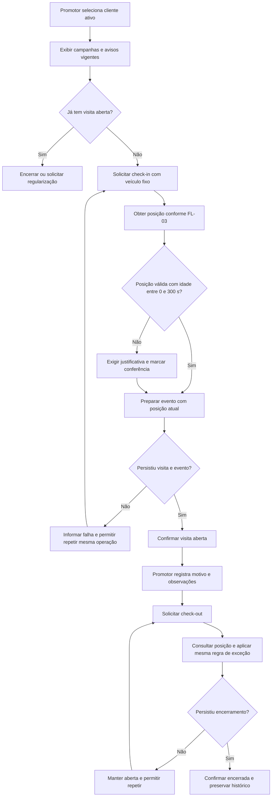
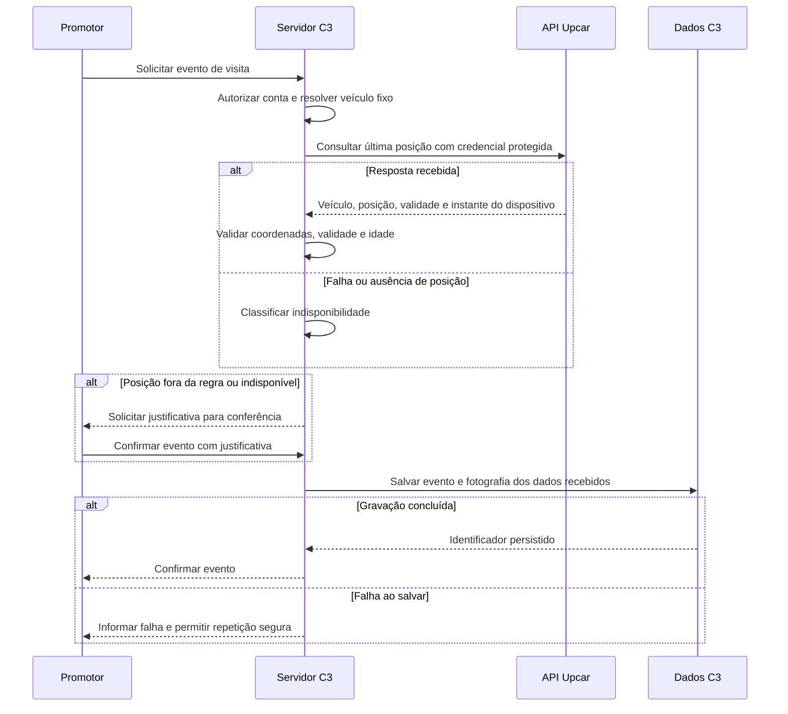
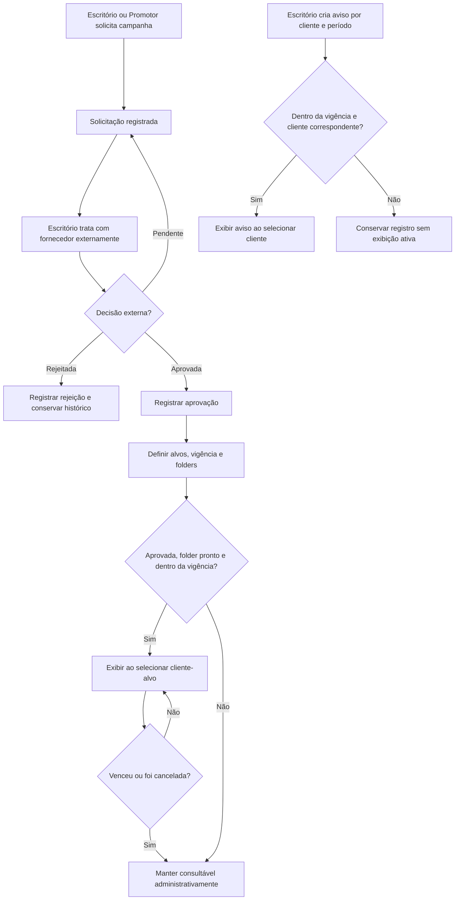
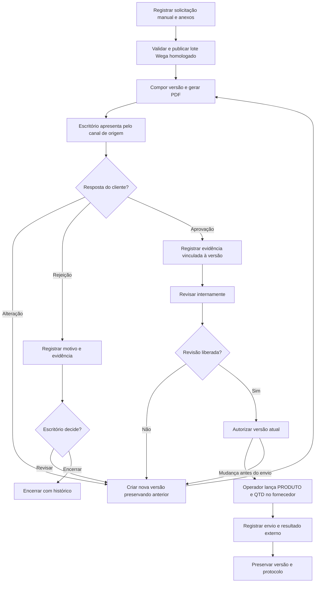
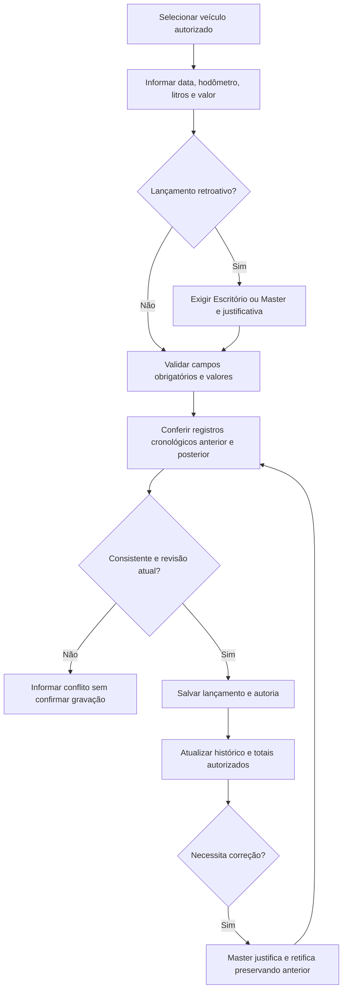

# Contexto e fluxos funcionais

Status PROPOSTO • ESF-C3-0.1 • 10/11/2026.

Diagramas Mermaid editáveis. Regras e critérios completos estão nos módulos RF e dicionário. Decisões na origem aprovadas permanecem citadas nesses módulos. Transições detalhadas desta versão são PROPOSTO. FL-01–06 cobrem os processos MVP e a fronteira da integração pontual com rastreador.

## FL-01 — Contexto, acesso e cadastros

RF-01 valida sessão e permissão antes de cada operação. RF-02 e RF-06.01 mantêm entidades. Master cria contas e vínculo fixo ao veículo. Nenhuma seta entre atores externos e Escritório representa integração automática da plataforma.

## FL-02 — Visita e gravação com exceções

RF-03.02/03 garantem uma visita aberta e idempotência. Falha ao consultar posição permite a exceção justificada. Falha na gravação não confirma o evento. Somente o Master regulariza registros encerrados/esquecidos, com horário informado separado do instante da correção.

## FL-03 — Posição pontual do veículo

Aplicam-se RF-03.09, D-06 e DP-03. Token, permissões reais, fuso da posição e latência aguardam homologação. O snapshot não muda depois do evento. Instantes de evento, consulta e dispositivo permanecem separados. Horário desconhecido/futuro, `valida=false` ou coordenadas inválidas exigem classificação de exceção. Timeout inicial de dez segundos é proposta D-06.

## FL-04 — Campanhas e avisos

Decisão externa e condição de exibição são dimensões distintas. Uma campanha aprovada pode estar futura, sem folder, ativa ou vencida. Cancelamento com motivo interrompe exibição e preserva histórico. Datas inclusivas são PT-05. RF-04 e RF-03.08 definem campos e critérios.

## FL-05 — Cotação, decisões e envio manual

### Dimensões e guardas de estado

| Dimensão | Valores e regra |
|---|---|
| Conteúdo | Rascunho editável antes de apresentação. Alteração de conteúdo apresentado gera sucessor numerado. Anterior permanece histórico |
| Resposta cliente por versão | RASCUNHO, APRESENTADA, ALTERACAO_SOLICITADA, APROVADA_CLIENTE, REJEITADA_CLIENTE. SUBSTITUIDA identifica versão sucedida sem apagar decisões anteriores |
| Revisão interna por versão | Sem revisão, AJUSTAR ou LIBERAR. Liberação só vale para conteúdo conferido |
| Autorização por versão | Ausente ou registrada com autor/instante. Requer cliente aprovado, revisão liberada e versão atual |
| Envio externo | Não enviado ou envio registrado para versão autorizada, com data e referência disponível |
| Resultado externo | PENDENTE, ACEITO ou REJEITADO propostos. Pedido aceito não equivale a compra faturada |
| Encerramento por rejeição | Escritório registra revisar ou encerrar com motivo. Revisar gera nova versão |
| Mudança após envio | PT-08 propõe Master para retificação interna e Escritório para tratar efeitos externos. Preservar o que foi efetivamente enviado |

RF-05 detalha cada guarda. As contagens administrativas informam qual dimensão está sendo contada. Revisão e autorização podem ser feitas pela mesma pessoa. Captura de respostas e envio ao fornecedor são operações humanas externas.

## FL-06 — Abastecimento e correção

RF-06 exige consistência do veículo sob concorrência. Data real do abastecimento e instante de inclusão são distintos. Empate de ordem no mesmo dia e troca de hodômetro são detalhes propostos em D-12. Correção substitui contribuição atual nos totais e conserva trilha.

## Verificação documental

Os diagramas foram revisados em conjunto com as tabelas de regras e critérios. A validação de execução ocorrerá na implementação. A renderização visual Mermaid ainda deverá ser conferida no visualizador adotado pelo projeto.
