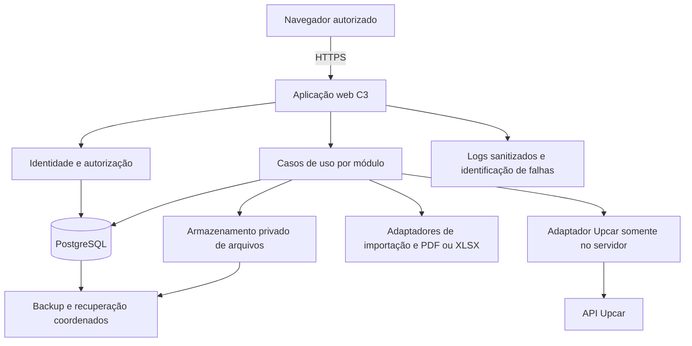

# Arquitetura preliminar C3

Status PROPOSTO • ARQ-C3-0.1 • 10/11/2026.

Base ESF-C3-0.1 revisão 1, F01 §8, F19/F23/F29/F35/F36, DEC-A01–03. F36 autoriza continuar o planejamento enquanto chegam os materiais. Este pacote propõe desenho e critérios de validação para revisão. A exclusividade do veículo é decisão aprovada em F35. As escolhas técnicas abaixo são PROPOSTO.

## Documentos do pacote

- [Avaliação de tecnologias](avaliacao-stack-v0.1.md).
- [Modelo lógico preliminar](modelo-dados-v0.1.md).
- [Decisões arquiteturais propostas](decisoes-arquiteturais-v0.1.md).
- [Backlog e estimativas](../06-planejamento/backlog-estimativas-v0.1.md).
- [Riscos e validações](../06-planejamento/riscos-validacoes-v0.1.md).
- [Estratégia de testes](../06-planejamento/estrategia-testes-v0.1.md).
- [Situação da Etapa 3](../06-planejamento/situacao-etapa-3.md).

## Estrutura proposta

Aplicação web mobile-first em monólito modular, com apresentação e servidor no mesmo projeto, PostgreSQL relacional e armazenamento privado de arquivos. Um processo Node.js atende operações da plataforma. Processamento de arquivos tem limites de tamanho/tempo e resultado persistido. A execução poderá compartilhar o serviço inicial se o ensaio de recursos permitir, mantendo estado recuperável dos lotes.

## Limites por módulo

| Módulo | Responsabilidade | Requisitos |
|---|---|---|
| Identidade | Contas, sessão, perfis fixos, recuperação assistida e autorização | RF-01, RF-02.02 |
| Cadastros | Clientes, fornecedores, associações, veículos e vínculo exclusivo por vigência | RF-02, RF-06.01 |
| Visitas | Abertura/encerramento, motivo, snapshot de posição e regularização | RF-03 |
| Campanhas | Solicitação, decisão externa, alvos, folders, vigência e avisos | RF-04, RF-03.08 |
| Pedidos | Solicitação, lote de fornecedor, versões, PDF, evidência e decisões humanas | RF-05 |
| Combustível | Lançamentos, retroatividade, cronologia e correções | RF-06 |
| Consultas | Projeções de leitura, filtros, totais, Excel e compras faturadas | RF-07 |
| Transversal | Arquivos privados, auditoria, transação e idempotência | CT e RNF-01–11 |

Cada caso de uso autoriza a operação e preserva invariantes. Consultas administrativas e de Promotor têm escopos explícitos. Componentes de interface reutilizam validações de formato, enquanto servidor e banco garantem regras e integridade. Uma consulta não depende de buscar posições externas para listar visitas históricas.

## Pedidos e documentos

O adaptador Wega converte apenas o layout homologado em linhas de um lote com proveniência. Os itens escolhidos são copiados para a versão da proposta, incluindo preço, mínimo e descrição. Nova publicação de tabela não atualiza proposta apresentada. PDF identifica a versão e os valores consolidados. Revisão, autorização, evidência e envio referenciam essa mesma versão.

Valores monetários usam decimal exato no cálculo e armazenamento. A escolha da biblioteca de decimal e dos geradores/leitores de PDF/XLSX depende de prova de compatibilidade e licença. O teste precisa conferir precisão, memória, proteção de arquivos e fidelidade do PDF esperado. Versão apresentada fica imutável quanto ao conteúdo. Mudança cria sucessor e exige as decisões aplicáveis à versão atual.

RF-07.05 usa uma fonte própria de compras faturadas. O contrato interno proposto recebe cliente, fornecedor, data, valor e referência de origem. A transformação concreta, identificação de duplicidades, devoluções e modo de atualização dependem de DP-01. Lotes de preço Wega e lotes de compras têm finalidades distintas e não alimentam automaticamente uns aos outros.

## Visita e API Upcar

1. Autenticar conta, identificar comando e resolver vínculo exclusivo vigente. Consultar resultado anterior da mesma operação antes de repetir efeitos.
2. Consultar a API fora da transação de gravação. Validar resposta, veículo, coordenadas, indicador de validade e instante da posição. O servidor guarda o contexto necessário à confirmação e sua autoria.
3. Se houver exceção, exigir justificativa. Contexto temporário de confirmação deve ser opaco, vinculado à conta/comando e ter expiração curta a validar. Coordenadas enviadas pelo navegador não substituem a fonte Upcar.
4. Antes de gravar, revalidar situação da conta, vínculo/veículo, visita aberta e idade da posição no instante efetivo do evento. Se a idade ultrapassou 300 s durante a confirmação, exigir a exceção correspondente.
5. Em transação curta, gravar visita/evento, fotografia dos dados, auditoria e resultado idempotente. Responder sucesso depois da persistência. Registrar instante de consulta, dispositivo e evento separadamente.

A regra aceita exatamente 300 segundos. Falha/posição inválida usa justificativa e conferência. Erro no banco exige repetir o comando e não pode ser classificado apenas como falha de localização. O servidor autentica no provedor com configuração protegida, renova credencial conforme contrato homologado e limita uma nova tentativa por falha transitória dentro do orçamento de dez segundos proposto. Permissão negada ou resposta incompatível requer diagnóstico, sem repetição ilimitada. F20/F21 divergem sobre o papel do token fornecido e exigem a prova DP-03.

## Concorrência e integridade

| Operação | Proteção proposta |
|---|---|
| Visita aberta | Restrição única para visita aberta por promotor, com transação e bloqueio do registro operacional pertinente |
| Vínculo de veículo | Unicidade de vínculo atual por promotor e por veículo. Bloquear entidades envolvidas em ordem estável, encerrar vigência anterior e iniciar nova na mesma transação |
| Correção de abastecimento ou retroativo | Serializar alterações por veículo e revalidar hodômetros vizinhos antes de confirmar |
| Alteração de versão/revisão/autorização | Conferir revisão esperada e versão atual sob transação, preservando decisões anteriores |
| Retentativa | Chave única por ator e comando, hash do conteúdo e resultado persistido. Mesma chave com conteúdo divergente é recusada |
| Publicação de lote | Validação em área temporária, publicação lógica única e transação de visibilidade. Falha conserva base anterior utilizável |
| Arquivo e banco | Arquivo primeiro em área privada temporária, depois validação e vínculo confirmado. Arquivo só é disponibilizado quando estado pronto. Falha conserva pendência rastreável e permite limpeza segura de órfãos |

Banco e armazenamento de arquivos têm confirmações distintas. O fluxo de estados de arquivo impede referência pronta a conteúdo ainda indisponível. Limpeza proposta usa prazo a definir e somente objetos temporários sem vínculo confirmado. Backups preservam manifesto de arquivos prontos e janela consistente da base para restauração conjunta.

## Segurança e operação

Autorização é aplicada em cada entrada do servidor e download. Sessões ficam sob solução consolidada, com revogação e recuperação assistida auditadas. URLs de download são mediadas pelo servidor ou assinadas por tempo curto após autorização. Credenciais Upcar e banco pertencem à configuração protegida, com rotação e acesso mínimo necessário. Logs têm correlação e classificação de falha, evitando dados pessoais completos e segredos.

Correções Master exigem motivo e preservam antes/depois. Usuário desativado mantém autoria histórica. Instantes são armazenados com fuso e exibidos em America/Fortaleza. Tratamento de dados, retenção e descarte dependem de política da C3 e revisão jurídica contratual. A implementação deve avaliar cookies, proteção de formulários, limitação de tentativas e cabeçalhos de segurança conforme o mecanismo escolhido.

## Hospedagem e custos

Proposta preferencial de aplicação Node.js, PostgreSQL e armazenamento de objetos privados em serviços gerenciados sob contas da C3, com homologação separada. Essa composição facilita operação por um responsável, condicionada à cotação e teste. Uma implantação em máquina virtual é alternativa de orçamento, com responsabilidade adicional sobre atualizações, cópias e recuperação. A avaliação não escolhe fornecedor nem plano.

| Parcela de custo | Dados necessários para cotar | Responsável |
|---|---|---|
| Aplicação e homologação | Recursos, região, tempo de execução, memória e tráfego | Ismael dimensiona, Caio aprova |
| PostgreSQL | Volume, conexões, retenção e recuperação | Ismael/Caio |
| Arquivos | Armazenamento, requisições, saída de dados e crescimento | Ismael/Caio |
| Cópias e monitoramento | Retenção, frequência, alertas e objetivo de recuperação | Ismael/Caio |
| Domínio e comunicação técnica | Titularidade de costaltda.com, DNS e necessidade de entrega de mensagens transacionais | C3 confirma, Ismael avalia |

Custos são da C3 conforme F29. Preços só serão apresentados com fornecedor, região, impostos/câmbio aplicáveis e data da cotação. RPO, RTO e disponibilidade dependem dessa aprovação. Recuperação assistida poderá usar canal de suporte já aprovado, com validação de identidade e segredo temporário, cujo procedimento precisa de revisão.

## Crescimento e validação

Índices seguem consultas por período, cliente, promotor, fornecedor e veículo. Consultas paginadas e agregações no banco evitam carregar a base inteira no navegador. Medir o cenário RNF-05 e tamanho dos arquivos antes de aumentar recursos ou separar processamento. Os próximos fornecedores entram por adaptador homologado, com impactos próprios. As validações técnicas estão no plano de riscos e testes do pacote.
