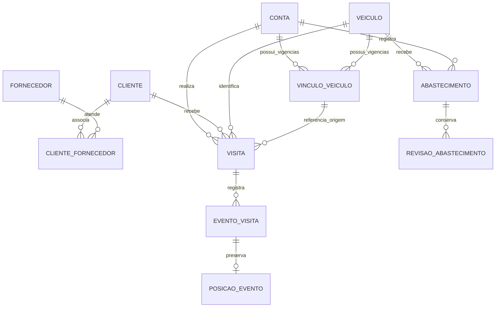
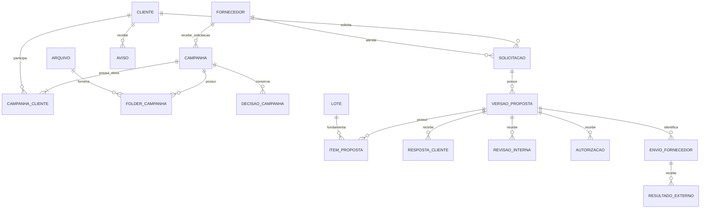

# Modelo lógico preliminar

Status PROPOSTO • ARQ-C3-0.1 • 10/11/2026.

Base no [dicionário D-01–13](../02-requisitos/dicionario-dados-v0.1.md), ESF-C3-0.1 revisão 1. Nomes e cardinalidades são proposta de modelagem. Tipos físicos, índices, tabelas da solução de identidade e migrações serão consolidados após a prova técnica. F35 aprova exclusividade atual do veículo por promotor.

## Convenções

Chaves internas opacas e estáveis. Instantes com fuso, datas civis separadas quando a regra usa dia. CNPJ textual normalizado, com formato numérico/alfanumérico. Campos de autoria apontam para conta preservada após desativação. Entidades editáveis têm revisão para conflito otimista. Listas e históricos usam paginação e ordem estável.

Valores exatos usam NUMERIC. Proposta física inicial de UNIT NUMERIC(20,6), total de cotação NUMERIC(20,3), quantidade Wega NUMERIC(16,0), litros/hodômetro NUMERIC(16,3) e valor de combustível NUMERIC(16,2). Validar limites e regra de arredondamento PT-03 antes de congelar. Cálculos na aplicação usam biblioteca decimal compatível. Formatação brasileira pertence à apresentação.

## Cadastros e visitas

| Entidade | Chaves e conteúdo principal | Integridade |
|---|---|---|
| Conta | Identidade, nome, e-mail, papel fixo, situação, revisão | E-mail normalizado único. Desativação preserva referências. Dados de sessão/credencial pertencem ao mecanismo escolhido |
| Cliente | ID, CNPJ, nome, endereço, cidade, UF, complementos e situação | CNPJ único inclusive em inativos. Retificação excepcional auditada |
| Fornecedor | ID, nome, código externo e situação | Nome normalizado único é proposta de detalhe, revisão com C3 |
| ClienteFornecedor | Cliente, fornecedor e vigência operacional | Evitar associação atual duplicada, conservar histórico relevante |
| Veículo | ID, placa, identificação, referência Upcar e situação | Placa única. Referência externa deve corresponder à conta de integração |
| VínculoVeículo | Conta Promotor, veículo, início/fim e autor | Um vínculo atual por conta e por veículo. Vigências sem sobreposição para ambos. Intervalo proposto fechado no início e aberto no fim |
| Visita | Cliente, promotor, veículo, vínculo de origem, início/fim, motivo, observações e situação | Uma visita aberta por promotor. Final maior ou igual ao início. Vínculo/veículo originais preservados |
| EventoVisita | Visita, tipo CHECKIN/CHECKOUT/REGULARIZACAO, instante e autor | Uma ocorrência ordinária de check-in e de check-out por visita. Correções acrescentam eventos, sem apagar original |
| PosiçãoEvento | Evento, veículo externo, coordenadas, origem, horários, condição, motivo de exceção | Relação no máximo uma fotografia de posição por evento. Conferência se indisponível/antiga/inválida. Evento de regularização não fabrica posição passada |
| Abastecimento | Veículo, data/hora ou ordem operacional, hodômetro, litros, total, autor e revisão atual | Valores positivos conforme dicionário e sequência cronológica consistente sob bloqueio por veículo |
| RevisãoAbastecimento | Registro, número da revisão, anterior/posterior, justificativa e autor | Revisão inicial e correções preservadas. Consultas somam apenas estado vigente |

Restrições únicas parciais protegem visita aberta e vínculos atuais. A validação de sobreposição de vigências usa bloqueios das entidades envolvidas na mesma transação. Alteração retroativa de vínculo exige análise Master, teste de sobreposição e preservação das visitas já registradas. O banco deve rejeitar associação concorrente de um veículo a dois promotores.

## Campanhas, avisos e pedidos

| Entidade | Conteúdo e relação | Integridade |
|---|---|---|
| Campanha | Fornecedor, solicitante, responsável, título, descrição, decisão e vigência | Um fornecedor, pelo menos um alvo. Ativa é condição calculada |
| CampanhaCliente | Campanha e cliente | Par único, vários clientes permitidos |
| FolderCampanha | Campanha e arquivo pronto, ordem e situação | Ativação requer ao menos um folder disponível. Substituição preserva proveniência |
| DecisãoCampanha | Resposta externa, cancelamento/retificação, motivo e autoria | Histórico de transições; retificação excepcional conserva anterior |
| Aviso | Cliente, texto, início/fim, autoria | Vigência inclusiva proposta, exibido no cliente pertinente |
| Solicitação | Cliente, fornecedor, canal, recebido_em, descrição e responsável | Uma solicitação pode ter várias versões, com referência à atual |
| VersãoProposta | Solicitação, número, snapshot de identificação, conteúdo, PDF e estado de apresentação | Número único por solicitação. Conteúdo imutável após apresentação. Estado não apaga decisões anteriores |
| ItemProposta | Versão, ordem, código, descrição, mínimo, quantidade, preço, total e referência de origem | Identidade e valores copiados da fonte, sem atualização automática por tabela posterior |
| RespostaCliente | Versão, decisão, data informada, evidência, motivo/encaminhamento e autor | Evidência obrigatória. Resposta antiga não autoriza sucessora |
| RevisãoInterna | Versão, revisão/conteúdo conferido, resultado, observação e autor | Liberação vale para conteúdo e versão conferidos |
| Autorização | Versão, conteúdo/revisão liberados, autor e instante | Exige aprovação cliente e liberação interna da versão atual. Histórico preservado |
| EnvioFornecedor | Versão autorizada, data, operador e referência externa | Registro manual vincula o que foi efetivamente enviado. Retentativa interna não duplica operação |
| ResultadoExterno | Envio, resultado, data, referência/observação e autor | Resultado não se converte automaticamente em compra faturada |

Anexos usam relações explícitas por finalidade, como ArquivoSolicitação e EvidênciaResposta. Estas relações referenciam Arquivo e a entidade autorizadora por chave estrangeira. Essa proposta evita um identificador genérico sem integridade referencial para todos os anexos. As relações são omitidas do diagrama para legibilidade.

## Arquivos, lotes, compras e auditoria

| Entidade | Conteúdo | Controle |
|---|---|---|
| Arquivo | Chave privada, nome original, tipo detectado, tamanho, hash, autor, estado e instante | TEMPORARIO, VALIDANDO, PRONTO ou REJEITADO propostos. Disponibilizar somente PRONTO e autorizado |
| Lote | Arquivo, fornecedor quando aplicável, finalidade, layout/revisão, hash, estado e autor | RECEBIDO, VALIDADO, REJEITADO, PUBLICADO. Identidade lógica inclui finalidade e fonte/layout para deduplicação |
| LinhaLote | Lote, número original, campos mapeados e erros | Área de preparação e proveniência da importação. Retenção física a definir. Não vira catálogo de produtos |
| CompraFaturada | Lote, cliente, fornecedor, data, valor, referência e ajuste | Modelo conceitual PENDENTE DP-01 quanto a granularidade, chave, devoluções e atualização |
| OperaçãoIdempotente | Ator, tipo de comando, chave, hash e resultado/entidade persistidos | Unicidade por ator/comando/chave, resultado confirmado junto ao fato. Política de retenção deve preservar janela de retentativa e impedir reaplicação indevida |
| EventoAuditoria | Entidade, ação, ator, instante, revisão, valores pertinentes e correlação | Gravado com a alteração obrigatória. Valores sensíveis omitidos. Retenção pendente da política |

CompraFaturada pode representar documento ou item conforme arquivo real. O desenho deve evitar contar o mesmo documento em nível de cabeçalho e de item. Não fixar chave de compra ou modo de substituição/incremento antes da amostra. Auditoria referencia entidade por identificador e tipo, com validação do caso de uso e política de preservação histórica.

## Índices e verificações propostas

| Consulta/regra | Índices ou prova planejada |
|---|---|
| Cliente por CNPJ | Índice único sobre CNPJ normalizado |
| Visita por autor/período ou cliente/período | Índices compostos com instante/ID para paginação estável |
| Visita aberta e vínculo atual | Índices únicos condicionados ao estado aberto/fim de vigência ausente |
| Campanhas por alvo e vigência | Índice por cliente/campanha e avaliação de período com volume RNF-05 |
| Pedido por fornecedor/cliente/data | Índices nas relações e recebimento. Versão atual sob integridade da mesma solicitação |
| Abastecimento por veículo/cronologia | Índice por veículo/data/ordem/ID e teste de vizinhos sob concorrência |
| Compras por cliente/fornecedor/data | Índice candidato, confirmar granularidade e atualização do layout |
| Lote e operação repetidos | Índices únicos para identidade lógica e comando idempotente |

Os índices finais serão medidos com planos de consulta no ambiente escolhido. A consistência de arquivos e base depende do procedimento de restauração conjunta. Os diagramas editáveis precisam de conferência visual no visualizador adotado, além da revisão de cardinalidades e regras.
